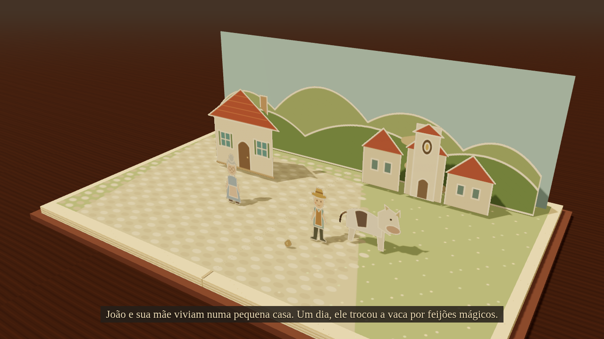

# Alves Pop-up — extensão para Mira

Contos em um livro pop-up 3D: recortes ilustrados, peças com dobradiças, chão texturizado, sombras reais, crescimento do pé de feijão, câmera e viradas de página. Primeiro conto: **João e o Pé de Feijão**, adaptação original em quatro cenas / 48 segundos.



[Vídeo de exemplo — João e o Pé de Feijão, 48 s](docs/joao-pop-up.mp4)

## O que acrescenta ao Mira

- Motor Three.js de palco tridimensional: livro, camadas, sombras e câmera em perspectiva.
- GSAP para a sequência de crescimento; tempo determinístico para exportação.
- Roteiro JSON validado, com câmera, personagens e legenda por cena.
- Agente `/alves-pop-up`, compatível com os plugins do Mira 0.1.69.
- Criação de decks autocontidos e renderização MP4 por Chromium + FFmpeg.

As cópias de **Three.js 0.160.0 e GSAP 3.13.0 são as distribuídas pelo Mira**, não dependências via CDN. A extensão usa o mecanismo oficial de agentes do Mira. Não é uma alteração oficial publicada pelo Sandeco nem uma nova versão do pacote npm `mira-animator`. Nenhuma parte do site de advocacia foi modificada.

## Experimentar o conto

Pré-requisitos: Node.js 22+, Chrome/Chromium com WebGL. Para assistir no navegador não precisa instalar pacotes:

```sh
cd tools/mira-pop-up
npm start
```

Abra `http://127.0.0.1:8137` no seu computador. O processo precisa continuar aberto. Não abra por `file://`: os módulos ES e o roteiro exigem HTTP local. A reprodução não acessa serviços externos. Pausar, recomeçar e percorrer a linha do tempo estão disponíveis.

## Instalar na sua pasta do Mira

Na pasta de trabalho das apresentações, com Mira já instalado por `npx mira-animator install`, execute o instalador desta extensão:

```sh
node /caminho/hub-alves-advogado/tools/mira-pop-up/scripts/install.mjs /caminho/minhas-apresentacoes
cd /caminho/minhas-apresentacoes
npx mira-animator plugin sync
```

Abra uma nova sessão do seu assistente e use **`/alves-pop-up`** (no Codex, mencione `alves-pop-up`). Exemplo: “Crie um vídeo de João e o Pé de Feijão em livro pop-up”.

O instalador acrescenta o motor em `.mira/extensions/alves-pop-up/`, o plugin em `mira-plugins/alves-pop-up/` e a skill nos diretórios configurados pelo Mira. Preserva a configuração do Mira e recusa sobrescrever uma instalação existente. O comando `plugin sync` registra a extensão no estado oficial do Mira. Para atualizar, preserve seus arquivos e remova somente a instalação anterior desta extensão antes de reinstalar.

**Formato da extensão:** `dist/alves-pop-up-0.1.0.mplug` contém apenas o agente. Isso respeita a restrição oficial de plugins `prompt-only`; um `.mplug` não pode incluir JavaScript. Portanto instale o motor pelo procedimento acima. O pacote completo é `dist/alves-pop-up-0.1.0.zip`, com o motor, agente, arte e scripts. Ao usar o ZIP, descompacte e execute os comandos dentro da pasta `alves-pop-up/` (equivalente a `tools/mira-pop-up/` no repositório). Instalar apenas o `.mplug` não basta para renderizar.

## Gerar outra apresentação

```sh
node scripts/create.mjs /caminho/minhas-apresentacoes/decks/joao-pop-up
# Ou um roteiro próprio compatível com o vocabulário atual:
node scripts/create.mjs /caminho/decks/meu-conto --story /caminho/roteiro.json
```

O arquivo `stories/joao.json` exemplifica o formato. O contrato está em `plugin/alves-pop-up/references/roteiro.md`. Para novos personagens e ações, é necessário ampliar a biblioteca e o motor: esta versão não converte arbitrariamente qualquer conto em arte inédita. As peças são planos ilustrados em espaço 3D; não são personagens volumétricos nem uma simulação física de dobraduras.

## Exportar MP4

Instale FFmpeg e Chrome/Chromium no computador. Instale as dependências desta extensão:

```sh
npm ci
npm run render
# Exportar um deck criado em outra pasta:
npm run render -- --deck /caminho/decks/joao-pop-up --out /caminho/video.mp4
```

Saída padrão: `output/joao-pop-up.mp4`, 1280×720, H.264, 24 fps. O renderizador inicia e encerra seu próprio servidor local. `CHROME_PATH` e `FFMPEG_PATH` permitem indicar executáveis instalados, inclusive no Windows. Caso o ambiente de execução em contêiner exija, `POPUP_NO_SANDBOX=1` é um opt-in explícito para Chromium; não é necessário no uso normal. `--preview` gera uma imagem; `--duration 3` permite um teste curto. Renderizar por software pode levar vários minutos.

**Áudio:** a versão 0.1.0 gera vídeo silencioso com legendas, sem TTS ou trilha. Não precisa de chave de IA para executar o exemplo. Gerar ou dirigir novos roteiros com a skill depende do assistente usado no Mira.

## Validação

```sh
npm test
npm run test:browser
```

Testes de contrato e criação/instalação; teste real de quatro cenas no Chromium com WebGL, quadros distintos, retorno determinístico ao mesmo instante e ausência de requisições externas. Também foram verificadas a validação e ativação pelo sincronizador do Mira 0.1.69. Os testes técnicos não significam que a arte reproduz exatamente o vídeo de referência; o estilo precisa ser avaliado visualmente.

## Origem e licença

Mira: `sandeco/mira-animator`, commit `d857f3270bdf29674cda28c31d2f7cf18a897811`, versão 0.1.69. Mantidos avisos e licença em `LICENSE-MIRA` e `vendor/`. Esta extensão é distribuída sob os mesmos termos não comerciais do Mira, respeitando as licenças próprias das bibliotecas. Ilustrações SVG e adaptação de João e o Pé de Feijão foram criadas para este projeto; não foram extraídas das imagens ou do vídeo de referência.
